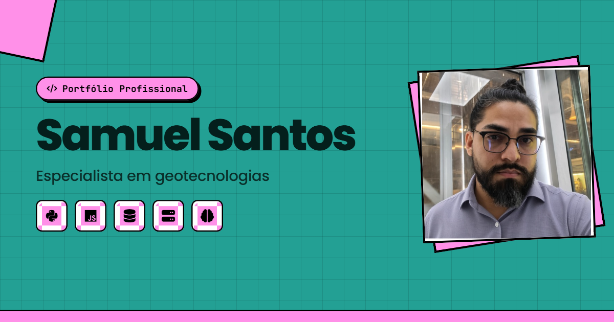
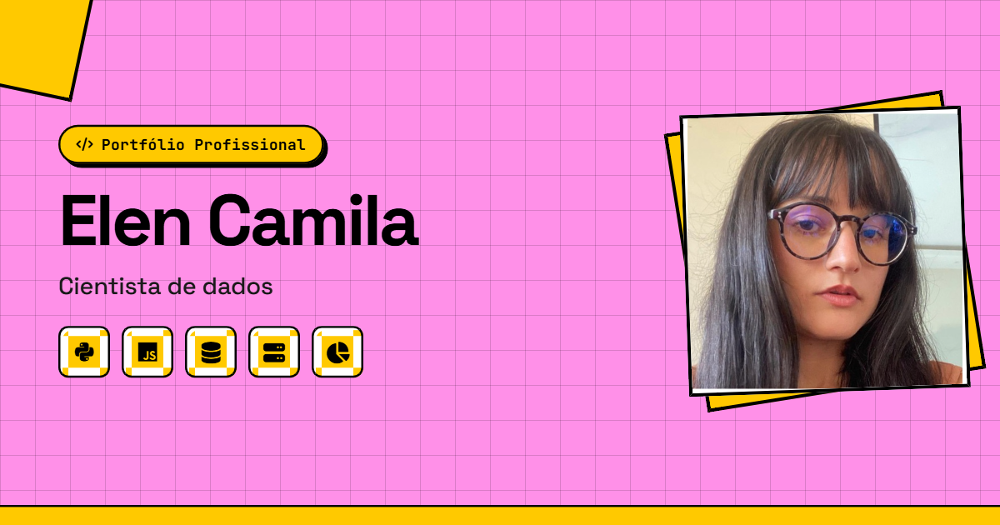

# Gerador de Thumbnail Personalizável

[](https://samuel-c-santos.github.io/gerador-de-thumbnail/)
[](LICENSE)

Gerador de cards **1200 × 630** (LinkedIn, Open Graph, capas em geral) com visual **neobrutalist**:
bordas grossas, sombras duras e cores berrantes na medida.

🔗 **Acesse a ferramenta online:** https://samuel-c-santos.github.io/gerador-de-thumbnail/

## Funcionalidades

* **Prévia fiel, sem compressão:** o card é renderizado em 1200 × 630 de verdade e só sofre *scale* para caber na tela — a proporção nunca deforma.
* **Texto em tempo real:** título, etiqueta (badge) e subtítulo, com ajuste automático do tamanho da fonte para nunca estourar o card.
* **Temas neobrutalist:** 8 paletas prontas, edição de cada cor em hexadecimal, paletas rápidas e rampa de destaque. O contraste do card (texto, bordas e ícones) é calculado automaticamente.
* **Fonte do card:** 9 opções (Archivo, Space Grotesk, Inter, Manrope, Poppins, Montserrat, Source Sans 3, Merriweather e JetBrains Mono).
* **Foto de perfil:** upload com recorte quadrado (1:1) via `Cropper.js`.
* **Tecnologias:** 29 ícones FontAwesome, até 5 no card.
* **Download PNG:** exportação exata em 1200 × 630, com nome de arquivo gerado a partir do título.
* **Privacidade:** todo o processamento acontece no navegador — nada é enviado para servidor.

## Exemplos gerados

Imagens geradas na versão anterior do card (o visual atual é neobrutalist):

| Perfil Dev (Samuel) | Variação de Cor | Perfil Profissional (Elen) |
|:---:|:---:|:---:|
|  |  |  |

## Tecnologias utilizadas

* **HTML5 & CSS3** (variáveis CSS para os temas dinâmicos)
* **JavaScript (ES6+)**
* **[html2canvas](https://html2canvas.hertzen.com/)**: renderiza o DOM como imagem para o PNG final
* **[Cropper.js](https://github.com/fengyuanchen/cropperjs)**: recorte da foto de perfil
* **FontAwesome**: biblioteca de ícones

## Como usar localmente

1. Clone o repositório:
   ```bash
   git clone https://github.com/samuel-c-santos/gerador-de-thumbnail.git
   ```
2. Entre na pasta:
   ```bash
   cd gerador-de-thumbnail
   ```
3. Abra o `index.html` no navegador (ou sirva a pasta com `npx serve .`).

Não há build, dependências para instalar nem backend: é um único arquivo HTML.

## Estrutura

```
index.html                      # aplicação completa (UI + card + exportação)
LICENSE                         # MIT
README.md
samuel-santos-thumbnail(-2).png # exemplos (versão anterior)
elen-camila-thumbnail.png       # exemplo (versão anterior)
```

## Licença

Distribuído sob a licença MIT. Veja [LICENSE](LICENSE).
